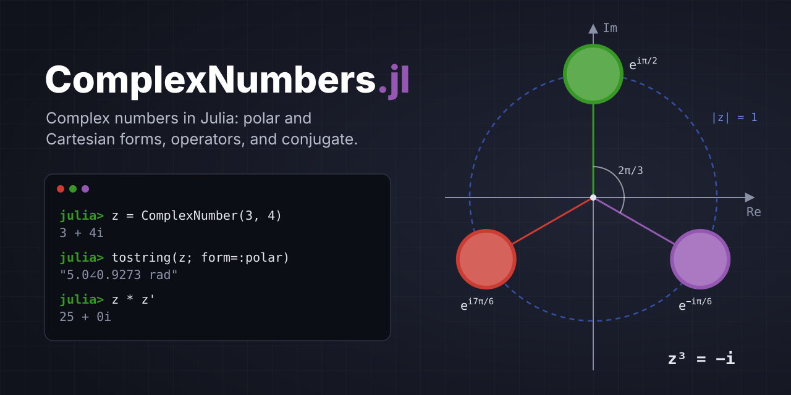

<div align="center">
    
</div>

A Julia package with a custom implementation of complex numbers, `ComplexNumber`, designed for study and teaching.

**Features**

- Conversion from **polar → Cartesian** and **Cartesian → polar** form (in radians or degrees)
- Conversion to a **string** in Cartesian or polar form (equivalent to Java's `toString`)
- **Operator overloading** for `+`, `-`, `*`, `/` between complex numbers and real numbers
- **Conjugate** with `conj(z)` or the postfix operator `z'`
- **Interoperability** with Julia's built-in `Complex` (`z + 10im`, `im * z`, ...)

---

## Requirements

- Julia **1.6** or later

## Installation

### From local code

Clone or copy the project and register it in your environment in development mode:

```julia
julia> using Pkg
julia> Pkg.develop(path="/path/to/complexnumbers")
```

Or, in the REPL's Pkg mode (press `]`):

```
pkg> dev /path/to/complexnumbers
```

Another option is to activate the project directly from its folder:

```bash
cd complexnumbers
julia --project=.
```

### From a git repository

Once the package is published in a repository (replace the URL with the real one):

```julia
julia> using Pkg
julia> Pkg.add(url="https://github.com/<username>/ComplexNumbers.jl")
```

### Loading the package

```julia
julia> using ComplexNumbers
```

### Tip: development with Revise.jl

The [Revise.jl](https://github.com/timholy/Revise.jl) automatically reloads code when you save a file, without restarting Julia. It **must be loaded before** the package:

```julia
julia> using Revise          # first
julia> using ComplexNumbers  # then
```

If the package was loaded before Revise, changes will not be tracked and you will need to restart the REPL. To never forget, add `using Revise` to the file `~/.julia/config/startup.jl`.

> Revise cannot redefine `struct`s. If you change the fields of `ComplexNumber`, restart Julia.

---

## Tutorial

### 1. Creating complex numbers

A `ComplexNumber` stores the real part (`re`) and the imaginary part (`im`) in Cartesian form `re + im·i`.

```julia
julia> z = ComplexNumber(3, 4)
3 + 4i

julia> ComplexNumber(2)            # real part only; the imaginary part becomes 0
2 + 0i

julia> ComplexNumber(1, 2.5)       # the types are promoted automatically
1.0 + 2.5i

julia> typeof(ComplexNumber(1, 2.5))
ComplexNumber{Float64}

julia> real(z)
3

julia> imag(z)
4
```

### 2. Cartesian → polar

In polar form, a complex number is described by its **modulus** `r = √(re² + im²)` and its **argument** (angle) `θ`, always in the interval (−π, π].

```julia
julia> modulus(z)
5.0

julia> argument(z)                 # in radians
0.9272952180016122

julia> argument(z; degrees=true)   # in degrees
53.13010235415598

julia> topolar(z)                  # tuple (r, θ)
(5.0, 0.9272952180016122)

julia> topolar(z; degrees=true)
(5.0, 53.13010235415598)
```

Julia's `abs` and `angle` functions also work:

```julia
julia> abs(z)
5.0

julia> angle(ComplexNumber(-1, 0))
3.141592653589793
```

### 3. Polar → Cartesian

`frompolar(r, θ)` creates a `ComplexNumber` from the modulus and the angle:

```julia
julia> frompolar(1, π/2)
0.0 + 1.0i

julia> frompolar(2, 30; degrees=true)
1.7321 + 1.0i
```

Round trip: converting to polar and then back to Cartesian returns the original number.

```julia
julia> frompolar(topolar(z)...)
3.0 + 4.0i
```

### 4. Converting to a string

`tostring` is the equivalent of Java's `toString`. By default, it uses the Cartesian form and rounds to 4 decimal places.

```julia
julia> tostring(z)
"3 + 4i"

julia> tostring(ComplexNumber(3, -4))
"3 - 4i"

julia> tostring(ComplexNumber(1/3, 2/3))
"0.3333 + 0.6667i"

julia> tostring(ComplexNumber(1/3, 2/3); digits=2)
"0.33 + 0.67i"
```

Polar form, in radians or degrees:

```julia
julia> tostring(z; form=:polar)
"5.0∠0.9273 rad"

julia> tostring(z; form=:polar, degrees=true)
"5.0∠53.1301°"

julia> tostring(z; form=:polar, degrees=true, digits=1)
"5.0∠53.1°"
```

The standard `string`, `print`, and `println` functions use the Cartesian form:

```julia
julia> string(z)
"3 + 4i"

julia> print(z)
3 + 4i
```

An invalid form raises an error:

```julia
julia> tostring(z; form=:xyz)
ERROR: ArgumentError: invalid form: :xyz; use :cartesian or :polar
```

### 5. Arithmetic operations

The operators `+`, `-`, `*`, and `/` work between two `ComplexNumber` values:

```julia
julia> a = ComplexNumber(1, 2)
1 + 2i

julia> b = ComplexNumber(3, 4)
3 + 4i

julia> a + b
4 + 6i

julia> a - b
-2 - 2i

julia> a * b
-5 + 10i

julia> a / b
0.44 + 0.08i

julia> -a                          # unary negation
-1 - 2i
```

They also work with real numbers, in either order:

```julia
julia> a + 2
3 + 2i

julia> 10 - a
9 - 2i

julia> 3a                          # Julia's implicit multiplication
3 + 6i

julia> a / 2
0.5 + 1.0i

julia> 1 / ComplexNumber(0, 1)     # 1/i = -i
0.0 - 1.0i
```

To compare floating-point results, prefer `≈` (`isapprox`, type `\approx<TAB>`) over `==`:

```julia
julia> (a / b) * b ≈ a
true
```

Dividing by zero raises `DivideError`:

```julia
julia> a / ComplexNumber(0, 0)
ERROR: DivideError: integer division error

julia> a / 0
ERROR: DivideError: integer division error
```

### 6. Conjugate

The conjugate of `re + im·i` is `re − im·i`. It can be obtained with `conj` or the postfix operator `'`:

```julia
julia> conj(z)
3 - 4i

julia> z'
3 - 4i

julia> (z')'                       # the conjugate of the conjugate is the number itself
3 + 4i
```

Classic properties:

```julia
julia> z * z'                      # z·z̄ = |z|²
25 + 0i

julia> z + z'                      # z + z̄ = 2·re
6 + 0i
```

### 7. Interoperability with Julia's `Complex`

Julia already has the `Complex` type (`3 + 4im`, `10im`, `im`). It can be freely mixed with `ComplexNumber`, and the result is always a `ComplexNumber`:

```julia
julia> z + 10im
3 + 14i

julia> 10im + z
3 + 14i

julia> im * z                      # multiplying by i rotates by 90°
-4 + 3i

julia> z / (1 + 1im)
3.5 + 0.5i

julia> z == 3 + 4im
true

julia> typeof(z + 1.5im)
ComplexNumber{Float64}
```

Explicit conversions between the two types:

```julia
julia> ComplexNumber(5 - 2im)
5 - 2i

julia> Complex(z)
3 + 4im
```

### 8. Complete example: series RLC circuit

In this example, we compute the impedance, current, and complex power of a circuit with R = 100 Ω, L = 0.5 H, and C = 100 µF, supplied by 220 V at 60 Hz.

```julia
julia> R, L, C, ω = 100.0, 0.5, 1e-4, 2π * 60
(100.0, 0.5, 0.0001, 376.99111843077515)

julia> ZR = ComplexNumber(R)                 # resistor
100.0 + 0.0i

julia> ZL = ComplexNumber(0, ω * L)          # inductor:  jωL
0.0 + 188.4956i

julia> ZC = 1 / ComplexNumber(0, ω * C)      # capacitor: 1/(jωC)
0.0 - 26.5258i

julia> Z = ZR + ZL + ZC                      # total impedance
100.0 + 161.9697i

julia> tostring(Z; form=:polar, degrees=true, digits=2)
"190.35∠58.31°"

julia> V = frompolar(220, 0; degrees=true)   # voltage 220∠0°
220.0 + 0.0i

julia> I = V / Z                             # Ohm's law
0.6072 - 0.9834i

julia> tostring(I; form=:polar, degrees=true, digits=3)
"1.156∠-58.309°"

julia> S = V * I'                            # complex power S = V·I*
133.5755 + 216.3519i

julia> tostring(S; digits=1)                 # P = 133.6 W, Q = 216.4 VAr
"133.6 + 216.4i"
```

---

## API reference

| Function / operator | Description |
|---|---|
| `ComplexNumber(re, im)` | Creates a complex number `re + im·i` |
| `ComplexNumber(x)` | Creates a complex number from a real (`x + 0i`) or a `Complex` |
| `real(z)`, `imag(z)` | Real and imaginary parts |
| `modulus(z)`, `abs(z)` | Modulus `√(re² + im²)` |
| `argument(z; degrees=false)`, `angle(z)` | Argument in the interval (−π, π] |
| `topolar(z; degrees=false)` | Tuple `(r, θ)` |
| `frompolar(r, θ; degrees=false)` | Creates a `ComplexNumber` from polar form |
| `tostring(z; form=:cartesian, digits=4, degrees=false)` | String in `:cartesian` or `:polar` form |
| `string(z)`, `print(z)` | String in Cartesian form |
| `+`, `-`, `*`, `/` | Arithmetic with `ComplexNumber`, `Real`, and `Complex` |
| `-z` | Negation |
| `==`, `≈` | Exact and approximate equality |
| `conj(z)`, `z'` | Conjugate |
| `Complex(z)` | Converts to Julia's built-in `Complex` |

## Running the tests

From the project root:

```bash
julia --project=. -e 'using Pkg; Pkg.test()'
```

Or, in the REPL with the project active, for a faster run during development:

```julia
julia> include("test/runtests.jl")
```

## A note on the name

The package is called `ComplexNumbers`, but the struct is called `ComplexNumber` (singular). In Julia, a module cannot contain a type with the same name as itself.
